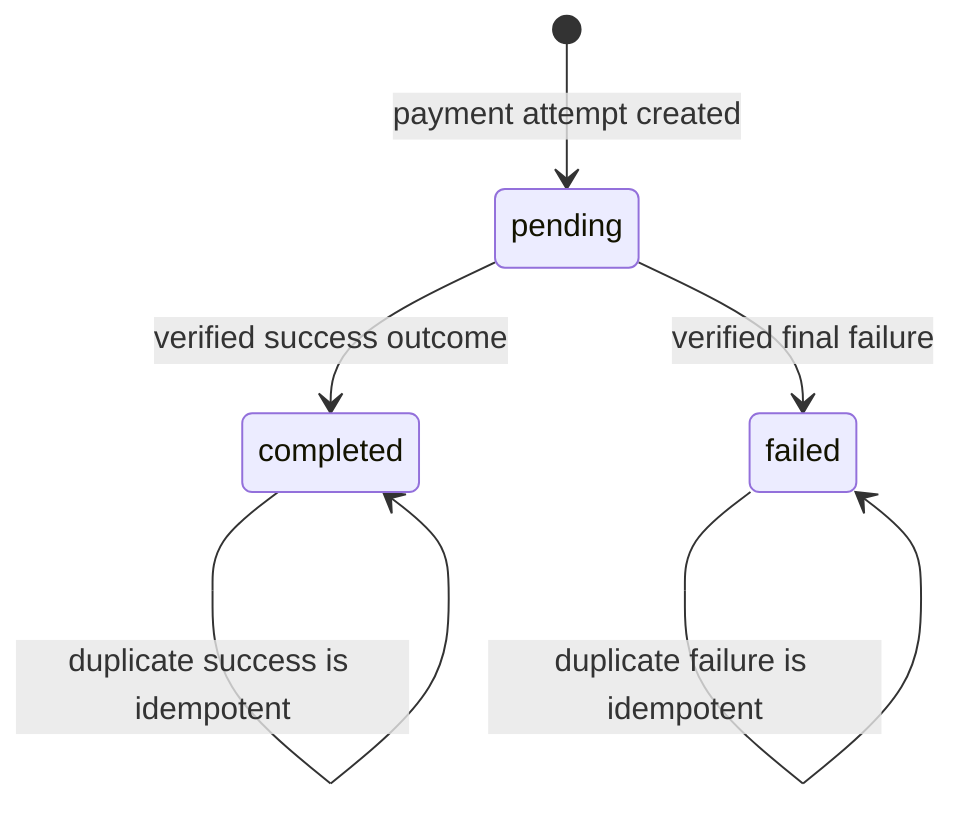
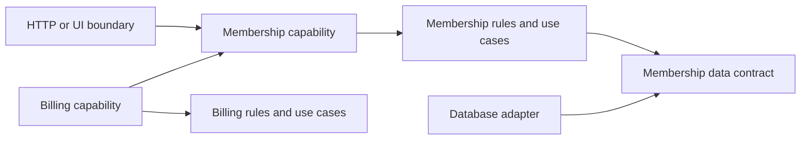

# Documentation examples

All names, states, limits, paths, and behavior in these examples are fictional teaching examples. Verify every claim in a real project before reusing it. The payment model below is one possible model, not a prescription.

## A. Rewrite an implementation inventory as an explanation

**Weak:**

> Payments use Provider X. `PaymentRepository` saves payment records. `PaymentService` calls the provider API. Webhooks update payment status. The system uses the Strategy pattern.

This names technologies and objects without explaining what “paid” means, which outcomes are allowed, or what happens when messages arrive more than once.

**Stronger concept-first opening:**

> A payment is an attempt to collect a specific amount for an order. The order becomes payable only after the application has accepted a verified provider outcome. A provider notification can arrive late or more than once, so processing must reconcile against the payment's current state and must not apply the same financial effect twice.

Then document the actual states, transitions, permissions, failure behavior, and caveats. Only after that, explain that a provider adapter and persistence boundary realize those rules, with links to their implementation. If the project allows different settlement semantics, state that explicitly rather than implying every provider has identical behavior.

## B. Explain a payment lifecycle

The following model is deliberately hypothetical. Confirm actual state names, authority, transition rules, event ordering, and recovery behavior before documenting a real payment system.

**Mental model:** the application records one payment attempt and moves it from `pending` to a verified final outcome. In this example, `completed` and `failed` are terminal. A client redirect can show progress but cannot establish a financial outcome; only a trusted server-side result or verified provider notification can do that.

**Rules to verify and document for the real system:**

- Which actor or server operation may create an attempt, and what order/amount it belongs to.
- Which verified events permit each transition; whether manual reconciliation is allowed.
- Whether a final state can ever be corrected, and which authority/process may correct it.
- What a duplicate event does. Reprocessing must not create a second charge, refund, receipt, or entitlement.
- How stale or out-of-order events are detected. If event order cannot be trusted, describe the actual reconciliation mechanism; do not invent one.
- Which transient provider failures are retried, with what idempotency protection, and when a human must intervene.
- What operators can see for a payment that remains pending, and how they can safely reconcile it.

In the example, an event that contradicts the stored final state is not silently applied. The system records enough information to investigate and reconciles with the authoritative payment source according to its verified integration contract. Real providers differ; link to the provider-specific integration reference for signature verification, event IDs, retries, and status retrieval.

The important caveat is that asynchronous notifications may be delayed, duplicated, or arrive after a user has left the page. Document the actual consistency delay and recovery route if known. Do not promise exactly-once delivery unless the end-to-end system truly provides it; describe idempotent handling instead.

## C. Explain a configuration caveat

**Fictional example only:** suppose an invitation policy allows at most 10 attempts per actor, per organization, per hour. That value and the path below are invented to demonstrate how to explain a limit.

> An actor can submit up to 10 invitation attempts to the same organization in one hour. The limit reduces accidental bursts and abuse while allowing a user to invite a small group. The application counts attempts, including rejected email addresses. When the limit is reached, the invite operation returns a recoverable “try later” result; it does not queue the extra attempts.
>
> The example value is defined in `src/features/invitations/domain/invitation-policy.ts` as `MAX_INVITATION_ATTEMPTS_PER_HOUR`. The policy is checked before sending email. Raising it increases outbound email volume and abuse exposure; lowering it can interrupt bulk onboarding. If changing the window, review the counter storage/expiry behavior and existing users' expectations as well as the constant.
>
> If an operator sees repeated limit failures, check the organization's recent attempt count and the limit-reached metric. Do not manually reset the counter unless the documented recovery procedure permits it.

For an actual project, verify the counting key, time window, whether failed attempts count, storage/expiry semantics, user-visible response, observability, configuration path, and effects of changing the limit. If one of these is unknown, call it out as unknown rather than copying the example's invented policy.

## D. Update docs after a behavior change

Assume a fictional code change adds two retries for a transient provider timeout. Before the change, the payment guide says a timeout leaves the attempt pending until reconciliation. The code now retries the same provider operation using the same idempotency key, then leaves the attempt pending if all attempts time out.

The targeted documentation update should change the relevant guide and operations note:

> A transient timeout is retried twice with the original idempotency key. If all attempts time out, the payment remains pending and is reconciled from a verified provider outcome. Operators should investigate attempts that remain pending beyond the configured reconciliation window.

Then verify the retry count, which errors qualify, backoff, idempotency-key reuse, reconciliation window, and any metrics from code/configuration. Update the sequence or troubleshooting guidance if the operator steps changed. Preserve unrelated state-machine explanation; do not regenerate the whole payment chapter or add a second document merely to record the code diff. If a consequential retry-policy decision has an ADR, link to it instead of duplicating its full rationale.

## E. Explain a modular monolith without listing folders

**Mental model:** a modular monolith is one deployable application with capabilities that own their rules and data access. A request can cross a capability boundary through an intentional API, while the modules still run in the same process and share a release lifecycle.

Read the diagram as ownership and allowed collaboration: billing may ask the membership capability for an intentional permission/capability result; it does not reach into membership persistence. The adapter fulfills a contract needed by membership behavior. A new service is not implied: split deployment only when independent ownership, scaling, security, or release needs justify the operational cost.

After explaining this model, document the project's actual boundary rules, notable exceptions, and the ADR that records a consequential choice. Link to enforcement configuration if import boundaries are checked automatically. A directory tree may be a useful short reference, but it is not the explanation.

## F. Choose the documentation scope

For a fictional subscription system, several related questions deserve different scopes:

| Reader question | Document type | Example title and content |
| --- | --- | --- |
| “How does renewal work?” | Concept | **Subscription lifecycle** — states, transitions, billing events, invariants, delayed outcomes. |
| “What can an organization admin change?” | Feature | **Managing a subscription** — user-visible options, permissions, business limits, consequences. |
| “How do I add a payment provider?” | Guide | **Integrating a payment provider** — boundary contract, verification steps, idempotency, tests, rollout. |
| “Why do billing and memberships own separate rules?” | Architecture | **Billing boundaries** — capability ownership, permitted dependencies, rationale, ADR link. |
| “What if renewal is stuck?” | Operations | **Recovering a delayed renewal** — signals, diagnostic order, safe reconciliation, escalation. |
| “What fields arrive in a renewal event?” | Reference | **Renewal event contract** — exact payload, field types, versioning, signature requirements. |

Link these documents where a reader moves naturally from concept to task or exact contract. Do not create all six just because six types exist: create only the material that answers a real question and is worth keeping current.
